# Agony — Java port

A Java port of the Amiga game **Agony** (Art & Magic / Psygnosis, 1992), made from
the original 68000 sources in `../sources/Agony`.

> Artwork: Franck Sauer, Marc Albinet — Code: Yves Grolet — 25/06/1990

The port keeps the structure of the original: the same two frame rates, the same
game variables, the same collision model, the same level script format. What the
Amiga did with the copper, the blitter and the sprite DMA is reproduced in
software, in classes that carry the name of the assembly block they come from.

## Screenshots

Rendered by the port from the original disks (`tools/Screenshots`).

| Presentation | | |
| --- | --- | --- |
| 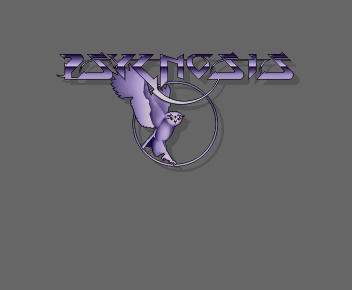 | 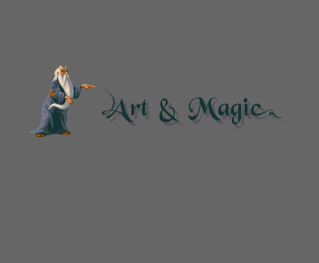 | 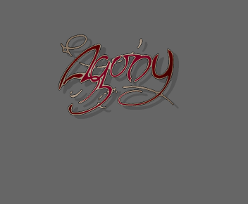 |

| Title | Hiscores | Loading |
| --- | --- | --- |
| 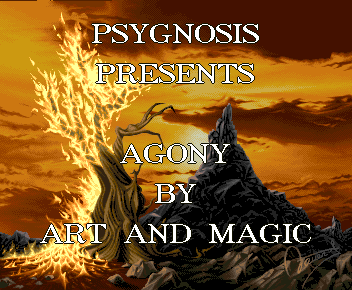 | 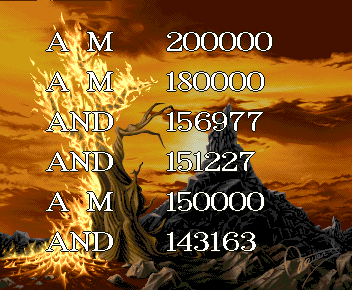 | 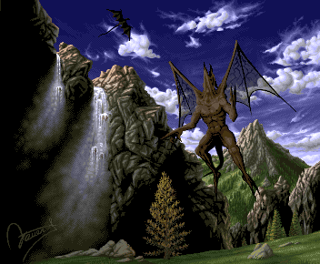 |

| Level | In play | Final monster |
| --- | --- | --- |
| 1, the sea | 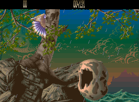 | 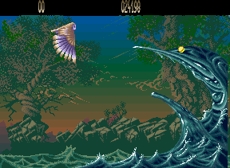 |
| 2, the forest | 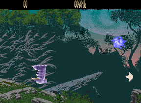 | 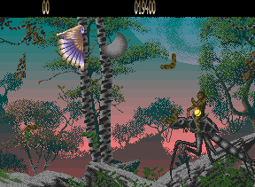 |
| 3, the marshes | 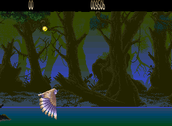 | 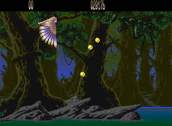 |
| 4, the mountains | 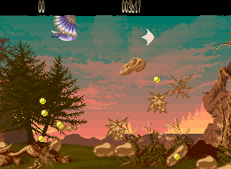 | 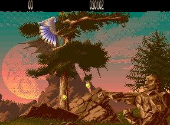 |
| 5, the highlands | 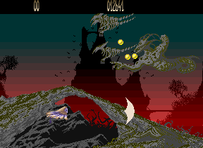 | 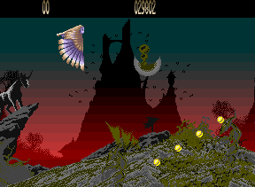 |
| 6, the fire | 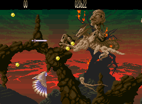 | 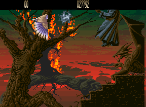 |

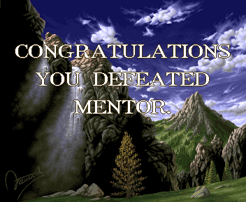

To render them again after a change:

```
./gradlew classes
java -cp build/classes/java/main com.artandmagic.agony.tools.Screenshots docs/screenshots
```

## Build and run

The repository sits beside the original material it reads:

```
agony/
├── adf/          the three original disk images (agony-1/2/3.adf)
├── sources/      the original 68000 sources (Agony, AgonyDosBoot, AgonyIntro, AgonyDemoDosBackup)
└── agony-java/   this project
```

Gradle (NetBeans and IntelliJ open the folder as a Gradle project):

```
./gradlew run
./gradlew run --args="--level=2"
./gradlew run --args="--invincible --level=1"   # --level skips the title
./gradlew run --args="--no-title"
./gradlew jar && java -jar build/libs/agony-java-1.0-SNAPSHOT.jar
```

Plain JDK 17 or newer, without Gradle:

```
javac -d build/classes $(find src/main/java -name '*.java')
java -cp build/classes com.artandmagic.agony.Main
```

To grab a frame without opening a window — useful on a build machine:

```
./gradlew screenshot -Pframes=600 -Pout=shot.png
./gradlew screenshot -Pframes=120 -Pout=menu.png -Pmode=menu
```

## Controls

| Key | Action |
| --- | --- |
| Arrows | Fly |
| Ctrl, Alt or Enter | Fire; hold for 30 frames to open the spell menu |
| Space | Spell menu (key `$40` of the original) |
| P | Pause (key `$19`) |
| Escape | Abort the level (key `$45`) |
| M | Toggle whether holding fire opens the menu (key `$37`) |
| F1..F4 | The debug keys of `Keyboard_Int`: lower axe, upper axe and all spells, next weapon, everything |
| F5 | Invincibility on or off (port only, also `--invincible` on the command line) |

## Where the assembly went

| Original | Java |
| --- | --- |
| `Agony_Parent_.s` main loop and interrupts | `game/AgonyGame` |
| `Agony_Parent_.s` variable block | `game/GameState` |
| `Ag_Front_Scroll_.s` | `game/FrontScroll` |
| `Ag_Back_Scroll.s` | `game/BackScroll` |
| `Ag_Object_.s` | `game/ObjectRenderer`, `core/Bitmap` |
| `Ag_Playability_.s` start list, tracks, palettes | `game/TrackManager`, `game/Track` |
| `Ag_Playability_.s` collision test | `game/Collisions` |
| `Ag_Sprites.s` sorcerer, fire, axes | `game/Player` |
| `Ag_Sprites.s` spell menu | `game/SpellMenu` |
| `Ag_Sprites.s` spell routines | `game/Spells` |
| `Ag_Sprites.s` death | `game/DeathSequence` |
| RAIN block of the video interrupt | `game/Rain` |
| `Ag_Sprites.s` bonuses | `game/BonusManager` |
| `Ag_Alien_Fire.s` | `game/AlienFire` |
| `Ag_Status.s` | `game/StatusBar` |
| `Ag_Sounds.s`, `Sound_Start` | `audio/SoundFx` |
| `Ag_Pt_Player.s` | `audio/ModPlayer`, `audio/Paula` |
| `Ag_Copper_List.s` | `core/Palette`, `core/Screen` |
| disk format, PP20, block layout | `data/original/Adf`, `PowerPacker`, `AgonyBinary` |
| `INCBIN` data to engine tables | `data/original/OriginalLevel` |
| `Muzack/*`, `Sounds/Sound.bin` | `data/original/OriginalMusic`, `OriginalLevel.sounds` |
| `Ag_Pre_comp.s` sprite masks | implicit: colour 0 is the mask (`core/Sprite`) |
| `Keyboard_Int` | `input/Joystick`, `AgonyGame.keyboard` |
| `AWO_`, `AWS_`, `TRACK STRUCT`, `AF_` records | `game/Alien`, `game/AlienBank`, `data/AttackWave`, `game/Track`, `game/AlienFire` |

### Timing

`Main` runs a 50 Hz loop. `AgonyGame.videoFrame()` is the level 3 interrupt and
calls `gameFrame()` every other time through `Gen_25hz_Phase`, so the hero moves
three pixels per video frame while the scenery scrolls two pixels per game
frame, exactly as on the Amiga.

### Display

304 by 192 lores, with a 19 line hires status bar above it, doubled into a
608 by 422 frame.  The width is not a guess: DDFSTRT $38 to DDFSTOP $c8 is 19
words, and both modulos agree with it, BPL1MOD 6 on the 44 byte front rows and
BPL2MOD 2 on the 40 byte back rows, so 38 bytes of each row reach the screen.
The status bar fetches 38 hires words for its 76 byte rows, which is the same
width again.  The display window runs from raster line $2d to line 256,
which is those 19 lines followed by the 192 of the playfield; the status bar has
two bitplanes, a lit pixel taking colour 3, and the copper walks that colour
down a gradient from $653, two lines at a time. The dual playfield is kept: playfield 1 is the front scroll in colours
1 to 7 with colour 0 transparent, playfield 2 is the sky and the back scroll in
colours 8 to 15, and the copper reloads both palettes every 32 lines, which is
modelled as six colour bands in `core/Palette`.

Two colours are not held for a whole band. The copper rewrites colour 0, the
background, on every single scanline, and colour 9, the bare sky, every ten;
together they are the vertical gradient a level is painted on. The port reads
both straight out of the copper list in the level overlay rather than deriving
them, so `data/original/OriginalLevel` walks the real instruction stream. The eight sprite channels each
hold a list of objects, the way the Amiga reuses one channel down the screen for
the twelve alien shots and the twenty four rain drops.

### Deliberate differences

* **Bitplanes.** The screens are one byte per pixel instead of three interleaved
  bitplanes. The stored value is the playfield colour, which is what the planes
  encode, so the twelve hand written blit routines of `Ag_Object_.s` collapse
  into one clipped blit.
* **Scrolling.** The original cycles three 44 byte screens and blits a character
  column over sixteen frames. Here the same 352 pixel buffer is a ring and the
  column that just left the screen is rebuilt in one go. The pristine copy used
  to erase the aliens survives as `FrontScroll.scenery`.
* **Alien shot groups.** The original reads past the end of `AF_LFO` when more
  than nine shots pile up within ten lines of each other; the port clamps to the
  last counter instead.
* **Short phase.** `Short_Phase` tells the original whether the main loop had
  time to spare, by comparing raster positions. There is no raster to race, so
  every frame counts as a short one.
* **Level routines.** The bosses and scripted sequences of `Ag_Game_*.s` are
  68000 code called from `Rout_Struct`. The slot machinery is here
  (`TrackManager.updateRoutines`, `data/Routine`), and the twelve routines of
  the first level are ported from `../sources/AgonyDosBoot/Ag_Game_LMER.s` into
  `game/routines` (`SeaRoutines`): all twenty five `Start_C` calls of the level
  one script resolve.  The five other levels are ported the same way from
  their own source, `Ag_Game_LFORET.s`, `AG_GAME_LMARAIS.S`,
  `AG_GAME_LMONTAGNES.S`, `Ag_Game_LPLATEAUX.s` and `Ag_Game_LFEUX.s`, into
  `ForestRoutines`, `MarshRoutines`, `MountainRoutines`, `HighlandRoutines` and
  `FireRoutines`; `Routines.forLevel` picks the library of a level.  A routine
  of the same name is not the same code from one level to the next (the ghost
  takes a palette in the sea and not in the forest, the guided missile flies
  three pixels a frame in the sea and two elsewhere), so each level has its own
  classes.  The compiled overlay is what the game runs and wins where it parts
  from the source file: the forest boss fires every twenty frames, not thirty,
  and sets `Quit_Delay` at its first explosion.  `tools/LevelProbe` lists the
  `Start_C` calls of a level and plays it headless to check them.
* **Bugs kept.** Where the original routines misbehave the port does too: the
  flame column writes its four phases to absolute addresses 2 and 6 instead of
  its variables, so the flames flicker in step; the tongue of the marsh boss
  counts its delay in the word at absolute address 2, taken to start at zero.
* **End of level.** Every level ends the way the original does: its final
  monster sets `Quit_Delay` once its explosions have gone off.  In the forest
  and the fire the scenery runs out a few lines before the script brings the
  boss in, so the port's own fallback, which ends a level once the scenery is
  over and the screen empty, waits for every routine of the script to have
  started.

## About the data

The source release is code only. Every `INCBIN` in `Agony_Parent_.s` points at
`WORK:Agony/` — the graphics, the maps, the object tables, the level scripts and
the music are on the game disks, and this repository holds none of them: the
port decodes everything from the original disk images when it starts.

### Getting the disks

The port looks for `.adf` images in the folder given with `--adf=<folder>`, then
in `adf` here or `../adf` beside the project, then in `~/.agony-java/adf`.  When
there are none, `data/original/DiskDownloader` fetches the three disks of the
hard disk release from the Amiga Museum, one zip archive each, keeps the image
inside and checks it against the SHA-256 of the known dump before using it.

Two releases of the disks are known and both are read:

| | Floppy release (Crystal crack) | Hard disk release (JOTD loader) |
| --- | --- | --- |
| Files | `Agony.00` to `Agony.14` | `intro.bin`, `menu.bin`, `code1-7.bin`, `end1-5.bin`, `endseq.bin`, `scores.sav` |
| Packer | PowerPacker (`PP20`) | the packer of the JOTD loader (`data/original/JotdPacker`) |
| Loader | `Crystal`, a ByteKiller packed boot | `AGONY`, an AmigaDOS executable |

Once unpacked the programs are the same, byte for byte, except for the 900 or
so bytes of disk routine each cracker patched in.  `data/original/Disks` gives
the hard disk files the names of the floppy release: the JOTD loader keeps a
table from the disk number and checksum of a `LOAD` call to a file name, and the
programs themselves pair every checksum with its file number.

### Reading the original disks

The chain is:

1. `data/original/Adf` reads the AmigaDOS volumes and `data/original/Disks`
   unpacks every file and names it `Agony.xx`.
2. `data/original/PowerPacker` and `data/original/JotdPacker` are the two
   decrunchers.
3. `data/original/AgonyBinary` locates the data blocks inside an overlay. The
   overlays are `Agony_Parent_.s` assembled at `ORG $600`, so each block sits at
   a fixed address, and the code names them: the absolute blocks through a 32 bit
   operand (`lea Sorcerer_Dat,a0`, `add.l #Front_Charset,d1`), the relative ones
   through the `d(a5)` displacement the `_` macro gives them. Generated tables
   whose contents are unmistakable (`X60`, `X384`, `Fwm_Conv`...) pin the rest of
   the layout down, and the result is cross checked: `X60 + 256` has to land on
   `Write_Table`, `X384 + 1024` on `Front_Mask`, `X44 + 386` on `Fwm_Conv`.
4. `data/original/OriginalLevel` converts what it finds.

Which level an overlay holds follows from the space `Sprites_Mask` reserves,
a different figure in each: 52000 bytes for the sea, 63500 for the fire level.
All six are on the disks, and `--level=<1-6>` picks one.

The level 1 layout the locator produces, as a worked example:

| Block | Address | Size |
| --- | --- | --- |
| `Sound_Dat` | `$005eee` | samples then the Protracker module |
| `Sorcerer_Dat` | `$0178c0` | 16 frames of the owl |
| `Sky_Dat` | `$0205b4` | 4 frames of 1440 bytes |
| `Back_Charset` | `$021c34` | |
| `Front_Charset` | `$030f34` | 164 characters of 384 bytes |
| `Sprites_Bitmap` | `$040534` | |
| `Objects_Struct` | `$04d054` | 1650 bytes |
| `Start_list` | `$04e0c6` | 96 entries |
| `Anim_Base` | `$04e974` | |
| `Rel_Start` | `$050ace` | |
| `Front_Map` | `$0536a2` | 310 columns of 12 bytes |
| `Front_Pal` | `$05452a` | 31 steps of 84 bytes |
| `Sprites_Struct` | `$05bffa` | 64 entries of 26 bytes |

The map and the palettes share one run of bytes with no marker between them;
they come apart because the map is twelve bytes per column, the palettes 84 bytes
per step, and the engine advances the palette once every ten columns — 310
columns and 31 steps, which fits exactly.

### Without the disks

With no `.adf` folder the port falls back on generated artwork:

* `data/PlaceholderAssets` builds the hero (an owl, as in the game), his shots,
  the axes, the spell icons, the bonuses, the explosions and the status font.
* `data/DemoLevel` builds a playable first level: a cave over a two layer sea,
  four palette steps, three kinds of alien with their movement tables, and a
  start list that releases a wave every few seconds.

They use the same structures the real data does (`LevelData`, `ObjectDef`,
`AttackWave`, `TrackTable`, `StartList`), so the engine cannot tell them apart.

Sound can also be supplied loose, from a `data` folder beside the game or one
given as the first argument, which is what happens when there are no disks:

* `music.mod` — the level music. `Ag_Pt_Player.s` is the Protracker V1.1B
  replayer, so the modules in `Muzack/` are ordinary Protracker songs;
  `audio/ModPlayer` plays them through the four channel Paula emulation.
* `sound0.raw` .. `sound3.raw` — the four effects of `Sounds/Sound.bin`, as raw
  signed eight bit samples, in the order the original numbers them: bonus taken,
  alien destroyed, sorcerer fires, alien hit.

### What the original data drives

Converted from the disks:

* the front scroll — characters, map and the 31 palette steps;
* the back scroll — characters, the sixteen patterns with their colours and
  their animation, `Back_Read.bin` and the frame table, replayed by the original
  algorithm rather than flattened;
* the sky plane, four tiles laid down the way the blitter does it;
* the aliens — sprites, object records, collision rectangles, animation tables.
  The blit class of a sprite says everything about how it is stored: classes 0
  to 3 are 32x32, 64x32, 32x64 and 64x64 in three colours, 4 to 7 the same in
  the other three, and 8 to 11 the same in seven with a precomputed mask, so a
  third of this level's sprites keep two bitplanes and not three;
* the vertical gradients of the background and of the sky, read from the copper
  list;
* the attack waves with their movement tables, and the level script.  There are
  two movement tables, and they are not read the same way: a relative track
  opens with the position its first alien starts at and takes its deltas from
  nibble `pos + 1`, subtracting two from every dx, while an absolute track takes
  its position from the start list entry and reads nibble `pos - 1`;
* the sorcerer, his axes, the four weapon levels, the bonuses, the death pieces,
  the spell menu icons and its cursor;
* the status font and the messages;
* the four sound effects of `Sounds/Sound.bin`;
* the Protracker modules: the intro, the end of game and one loading tune per
  level, all credited to m.w and r.l, 1991. This release keeps no in game module
  in the level overlay, so the port plays the tune belonging to the level.

* the spell graphics, and the tables that go with them: the arc the axes swing
  along, the eight rotation steps of the rotative fire ball, the wave of the
  forward fire ball, the fall of the hour glass, the paths of the eight death
  pieces and the rain offsets.

Nothing in the port is a guess at those tables any more; every one of them is
read from the disks, and the blocks they live in are cross checked against the
sizes the code implies, down to the byte: `Smart_B_Spr` spans 7540 bytes, which
is two sets of six 628 byte frames plus a terminator, `Time_Spr` 4100, which is
sixteen shapes of 256, and so on all the way from `Rot_Table` to `Status_Digit`.

### The game flow

`Agony_Parent_.s` ends a level by fading the screen, waiting fifty frames and
loading the next file, or the game over screen when the last life is gone.  It
names that file with a `FILE_x_y` constant, and `DISK/load_label.s` says what
each one is, so the whole chain is on record:

| Level | Loads on exit | Which is |
| --- | --- | --- |
| 1 sea | `FILE_1_4` | `load_forest` |
| 2 forest | `FILE_1_6` | `load_marshes` |
| 3 marshes | `FILE_2_2` | `load_mountains` |
| 4 mountains | `FILE_2_4` | `load_highlands` |
| 5 highlands | `FILE_2_6` | `load_fire` |
| 6 fire | `FILE_0_3` | `ending` |
| game over | `FILE_1_1` | `igt` |

Each loading file is a program of its own, and the tune it carries is the one the
port plays for the level that follows it.  The whole chain, read from the `LOAD`
calls of every program, is:

```
boot -> Agony.01 intro -> Agony.07 title -> Agony.08 loading -> Agony.09 level 1
     -> 0A loading -> 0B level 2 -> 0C -> 0F level 3 -> 10 -> 11 level 4
     -> 12 -> 13 level 5 -> 14 -> 02 level 6 -> 03 ending -> 07 title
```

and every level loads the title, `Agony.07`, when the last life is gone.  `Main`
follows it: the title, then each level behind its loading screen, carrying the
score, the lives, the weapon, the axes and the spells across, the ending after
the sixth, and the title again, which asks for initials when the score gets into
the table.  The presentation, `Agony.01`, plays once before the first title.

### How the original loads anything

`LOAD FILE_x_y,addr` in `DISK/load.s` hands the trackloader a disk number, a file
number and a checksum, all constants out of `load_label.s`, and drops the file at
`addr`.  A level does that once, at its exit, and jumps into what it loaded: the
levels do not load pictures, they load the next program.

Pictures themselves are raw planar blobs whose address goes straight into a
copper bitplane pointer.  `DISK/Insert_Disk.s` is the one worked example in the
release: it writes `#id_image` into `id_clp`, the pointer of its own copper list,
and patches the disk digit into the bitmap from a small charset kept at
`id_image+180`.  Nothing decodes or converts anything; the blob is the screen.

One piece of the flow is still missing from the release, and the port says
so rather than pretending otherwise:

* **`SetFade`** lives in `WORK:Global` and is not in the release; the port ramps
  the frame down over the same delay the original waits.

### The programs with no source

The loading screens, the title and the ending have no source in the release.
They are read from their 68000 code instead, by the instructions that use the
data (`data/original/Code`): the address a program is assembled at follows from
its copper list and its vertical blank handler, the picture from
`move.l #planes,d0` and `addi.l #stride,d0`, the palette from the fade routine.
Nothing is keyed on a file name or an offset.

* **Loading screens** (`data/original/LoadingScreens`, `screens/LoadingScreen`):
  a 352 by 290 overscan picture of six planes, extra half brite, faded in over
  seventeen frames and out the same way, with the loading tune.
* **Title** (`data/original/TitleData`, `screens/TitleScreen`): a picture of the
  same kind, a one plane 32 by 20 font, fifteen text pages (the credits, the
  story, the initials prompt) and the hiscore table, cycled on the timings of
  the program.  The table starts from `Agony.00` (`scores.sav`) and is saved in
  `~/.agony-java/hiscores.bin`; the disk images are never written to.
* **Ending** (`screens/EndingScreen`): the same engine, ten pages, the end of
  the story and the greetings.
* **Presentation** (`data/original/IntroData`, `screens/IntroScreen`): six
  hires interlace pictures (the hi-fi hint, the Psygnosis owl lit by a sweep of
  colour, "and", Art & Magic, "Present", the Agony logo) with sampled sound
  played straight through the audio registers.  The program is straight line
  code, read instruction by instruction into a script of pictures, fades, waits
  and sounds; the fades and the volume envelopes of its vertical blank handler
  are reproduced on the same timings.  The long animated intro of the original
  release (`FILE_0_3`, `System:ag/intro` in `load_label.s`) is on neither of the
  known dumps: the presentation goes straight to the title.

### Notes on the original formats

* `Objects.sst` — 26 bytes per sprite: width, height, then a word giving the
  blit class (0..11, which picks the size and the shift), four routine pointers
  filled in at boot by `Ag_Pre_comp.s`, the bitmap offset and the mask offset.
  Classes 8 to 11 are 32x32, 64x32, 32x64 and 64x64 and get a precomputed mask.
* `Objects.obj` — per alien: a word offset to the collision rectangles, the byte
  offsets of the muzzle it fires from, then (dx, dy, sprite) triplets ended by
  dy = `$80`. Rectangles are (x1, y1, x2, y2) bytes ended by x1 = `$80`.
* `Front.Map` — read one character at a time, six characters per column, with
  the next character read as well to build the overlap mask; the read pointer
  advances two bytes per character.
* `Front.Bin` — 384 bytes per character: 32 by 32 pixels over three bitplanes.
* `Front.Pal` — seven colours per band, six bands per palette step, one step
  every ten character columns.
* `Back.pat`, `Back.frm`, `Back.inf` — the back scroll patterns, their animation
  frames and the per character mode and offset table.
* Coordinates in `AWO_Alien_X`, `Sorcerer_X` and `Good_Col_List` are all biased
  by 256, which is why `Hw.BIAS` appears throughout the port.
