# Agony — portage Java

*[English version](README.md)*

Un portage Java du jeu Amiga **Agony** (Art & Magic / Psygnosis, 1992), réalisé à
partir des sources 68000 d'origine, dans `../sources/Agony`.

> Graphismes : Franck Sauer, Marc Albinet — Code : Yves Grolet — 25/06/1990

Le portage garde la structure de l'original : les deux mêmes fréquences d'images,
les mêmes variables de jeu, le même modèle de collision, le même format de script
de niveau. Ce que l'Amiga faisait avec le copper, le blitter et le DMA des sprites
est reproduit en logiciel, dans des classes qui portent le nom du bloc assembleur
dont elles viennent.

## Captures d'écran

Rendues par le portage à partir des disquettes d'origine (`tools/Screenshots`).

| Présentation | | |
| --- | --- | --- |
| 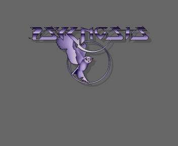 | 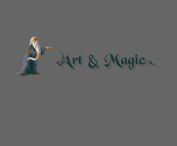 | 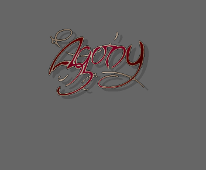 |

| Titre | Meilleurs scores | Chargement |
| --- | --- | --- |
| 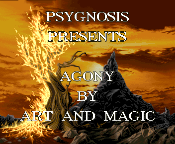 | 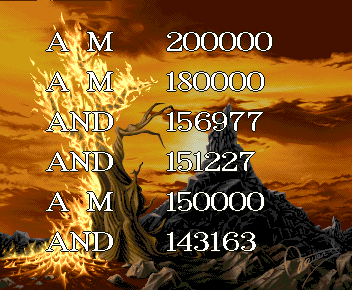 | 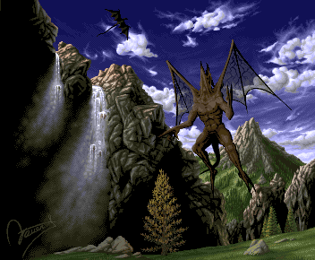 |

| Niveau | En jeu | Monstre final |
| --- | --- | --- |
| 1, la mer | 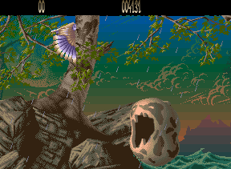 | 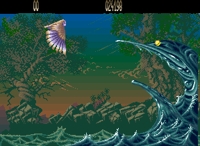 |
| 2, la forêt | 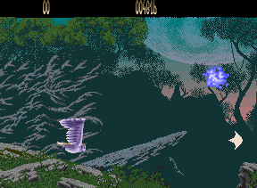 | 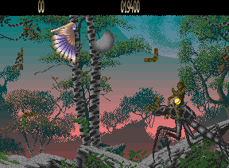 |
| 3, les marais | 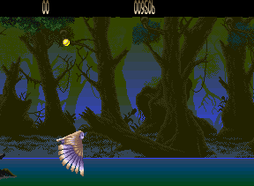 | 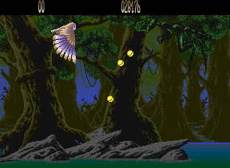 |
| 4, les montagnes | 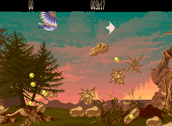 | 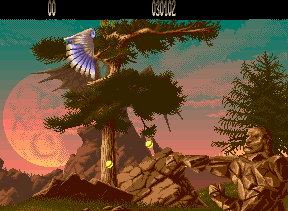 |
| 5, les plateaux | 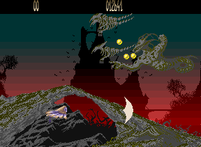 | 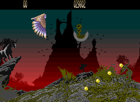 |
| 6, le feu | 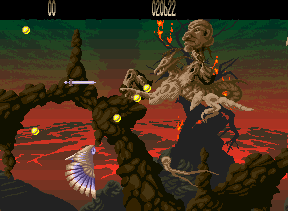 | 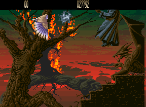 |

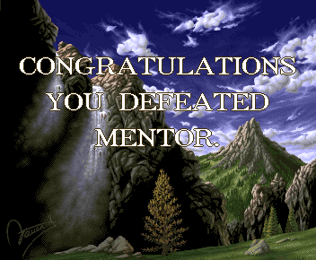

Pour les régénérer après une modification :

```
./gradlew classes
java -cp build/classes/java/main com.artandmagic.agony.tools.Screenshots docs/screenshots
```

## Compiler et lancer

Le dépôt se trouve à côté du matériel d'origine qu'il lit :

```
agony/
├── adf/          les trois images disquette d'origine (agony-1/2/3.adf)
├── sources/      les sources 68000 d'origine (Agony, AgonyDosBoot, AgonyIntro, AgonyDemoDosBackup)
└── agony-java/   ce projet
```

Gradle (NetBeans et IntelliJ ouvrent le dossier comme un projet Gradle) :

```
./gradlew run
./gradlew run --args="--level=2"
./gradlew run --args="--invincible --level=1"   # --level saute l'écran titre
./gradlew run --args="--no-title"
./gradlew jar && java -jar build/libs/agony-java-1.0.0.jar
```

### Version distribuable

`./gradlew release` empaquette le jeu avec jpackage dans
`build/release/Agony-<version>-<os>-x64.zip` : le lanceur (`Agony.exe` sous
Windows), le jeu et un environnement d'exécution Java réduit aux modules qu'il
utilise, environ 26 Mo, sans aucune donnée du jeu. Décompressez-le n'importe où
et lancez `Agony` : au premier démarrage, une fenêtre montre le téléchargement
des trois disquettes dans `~/.agony-java/adf`, et le jeu s'ouvre une fois
qu'elles sont là et vérifiées. `./gradlew jpackage -Ptype=msi` (ou `exe`, `deb`,
`dmg`…) construit plutôt un installateur, avec les outils dont jpackage a besoin
pour ce type (WiX sous Windows).

Le jeu empaqueté n'a pas de `../sources` à côté de lui : les deux modules de
niveau conservés uniquement dans `AgonyDemoDosBackup` (la mer et la forêt) n'y
sont donc pas ; ces deux niveaux jouent la musique de leur écran de chargement,
qui se trouve sur les disquettes.

Avec un simple JDK 17 ou plus récent, sans Gradle :

```
javac -d build/classes $(find src/main/java -name '*.java')
java -cp build/classes com.artandmagic.agony.Main
```

Pour capturer une image sans ouvrir de fenêtre — pratique sur une machine de
compilation :

```
./gradlew screenshot -Pframes=600 -Pout=shot.png
./gradlew screenshot -Pframes=120 -Pout=menu.png -Pmode=menu
```

## Commandes

| Touche | Action |
| --- | --- |
| Flèches | Voler |
| Ctrl, Alt ou Entrée | Tirer (le maintenir n'ouvre le menu des sorts qu'une fois cette option activée avec M) |
| Espace | Menu des sorts (touche `$40` de l'original) |
| P | Pause (touche `$19`) |
| Échap | Abandonner le niveau (touche `$45`) |
| M | Active ou désactive l'ouverture du menu en maintenant le tir 30 images, désactivée au départ (touche `$37`) |
| F1..F4 | Les touches de débogage de `Keyboard_Int` : hache basse, hache haute et tous les sorts, arme suivante, tout |
| F5 | Invincibilité activée ou désactivée (propre au portage, aussi `--invincible` en ligne de commande) |

## Où est passé l'assembleur

| Original | Java |
| --- | --- |
| `Agony_Parent_.s` boucle principale et interruptions | `game/AgonyGame` |
| `Agony_Parent_.s` bloc de variables | `game/GameState` |
| `Ag_Front_Scroll_.s` | `game/FrontScroll` |
| `Ag_Back_Scroll.s` | `game/BackScroll` |
| `Ag_Object_.s` | `game/ObjectRenderer`, `core/Bitmap` |
| `Ag_Playability_.s` liste de départ, trajectoires, palettes | `game/TrackManager`, `game/Track` |
| `Ag_Playability_.s` test de collision | `game/Collisions` |
| `Ag_Sprites.s` sorcier, tir, haches | `game/Player` |
| `Ag_Sprites.s` menu des sorts | `game/SpellMenu` |
| `Ag_Sprites.s` routines des sorts | `game/Spells` |
| `Ag_Sprites.s` mort | `game/DeathSequence` |
| Bloc RAIN de l'interruption vidéo | `game/Rain` |
| `Ag_Sprites.s` bonus | `game/BonusManager` |
| `Ag_Alien_Fire.s` | `game/AlienFire` |
| `Ag_Status.s` | `game/StatusBar` |
| `Ag_Sounds.s`, `Sound_Start` | `audio/SoundFx` |
| `Ag_Pt_Player.s` | `audio/ModPlayer`, `audio/Paula` |
| `Ag_Copper_List.s` | `core/Palette`, `core/Screen` |
| format des disquettes, PP20, disposition des blocs | `data/original/Adf`, `PowerPacker`, `AgonyBinary` |
| données `INCBIN` vers les tables du moteur | `data/original/OriginalLevel` |
| `Muzack/*`, `Sounds/Sound.bin` | `data/original/OriginalMusic`, `OriginalLevel.sounds` |
| `Ag_Pre_comp.s` masques des sprites | implicite : la couleur 0 sert de masque (`core/Sprite`) |
| `Keyboard_Int` | `input/Joystick`, `AgonyGame.keyboard` |
| Enregistrements `AWO_`, `AWS_`, `TRACK STRUCT`, `AF_` | `game/Alien`, `game/AlienBank`, `data/AttackWave`, `game/Track`, `game/AlienFire` |

### Cadencement

`Main` fait tourner une boucle à 50 Hz. `AgonyGame.videoFrame()` est l'interruption
de niveau 3 et appelle `gameFrame()` une fois sur deux via `Gen_25hz_Phase` : le
héros se déplace donc de trois pixels par image vidéo pendant que le décor défile
de deux pixels par image de jeu, exactement comme sur l'Amiga.

### Affichage

304 sur 192 en lores, avec une barre d'état hires de 19 lignes au-dessus, doublé
dans une image de 608 sur 422. La largeur n'est pas devinée : de DDFSTRT $38 à
DDFSTOP $c8, cela fait 19 mots, et les deux modulos concordent, BPL1MOD 6 sur les
lignes de 44 octets du premier plan et BPL2MOD 2 sur les lignes de 40 octets de
l'arrière-plan, si bien que 38 octets de chaque ligne arrivent à l'écran. La barre
d'état lit 38 mots hires pour ses lignes de 76 octets, ce qui donne encore la même
largeur. La fenêtre d'affichage va de la ligne raster $2d à la ligne 256, soit ces
19 lignes suivies des 192 de l'aire de jeu ; la barre d'état a deux plans de bits,
un pixel allumé prenant la couleur 3, et le copper fait descendre cette couleur le
long d'un dégradé à partir de $653, deux lignes à la fois. Le dual playfield est
conservé : le playfield 1 est le défilement avant, dans les couleurs 1 à 7 avec la
couleur 0 transparente, le playfield 2 est le ciel et le défilement arrière, dans
les couleurs 8 à 15, et le copper recharge les deux palettes toutes les 32 lignes,
ce qui est modélisé par six bandes de couleur dans `core/Palette`.

Deux couleurs ne restent pas fixes sur toute une bande. Le copper réécrit la
couleur 0, le fond, à chaque ligne de balayage, et la couleur 9, le ciel nu, toutes
les dix ; ensemble, elles forment le dégradé vertical sur lequel un niveau est
peint. Le portage les lit toutes deux directement dans la liste copper de
l'overlay du niveau au lieu de les déduire, si bien que
`data/original/OriginalLevel` parcourt le vrai flux d'instructions. Les huit
canaux de sprites contiennent chacun une liste d'objets, de la même façon que
l'Amiga réutilise un canal plus bas dans l'écran pour les douze tirs aliens et les
vingt-quatre gouttes de pluie.

### Différences délibérées

* **Plans de bits.** Les écrans utilisent un octet par pixel au lieu de trois plans
  de bits entrelacés. La valeur stockée est la couleur du playfield, ce que codent
  justement les plans, si bien que les douze routines de blit écrites à la main de
  `Ag_Object_.s` se réduisent à un seul blit avec découpage.
* **Défilement.** L'original fait tourner trois écrans de 44 octets et blitte une
  colonne de caractères sur seize images, à 40 octets dans l'écran en construction
  (`Front_Table`), juste à droite de ce que montre la fenêtre : un niveau commence
  sur un playfield avant vide et la carte arrive par la droite. Ici, le même tampon
  de 352 pixels est circulaire et chaque colonne est construite d'un coup, à ce même
  endroit. La copie intacte qui sert à effacer les aliens subsiste sous la forme de
  `FrontScroll.scenery`.
* **Groupes de tirs aliens.** L'original lit au-delà de la fin de `AF_LFO` quand
  plus de neuf tirs s'accumulent à moins de dix lignes les uns des autres ; le
  portage s'arrête plutôt au dernier compteur.
* **Phase courte.** `Short_Phase` indique à l'original si la boucle principale
  avait du temps de reste, en comparant des positions du raster. Il n'y a pas de
  raster à devancer, donc chaque image compte comme une image courte.
* **Routines de niveau.** Les boss et les séquences scriptées de `Ag_Game_*.s`
  sont du code 68000 appelé depuis `Rout_Struct`. La mécanique des emplacements
  est là (`TrackManager.updateRoutines`, `data/Routine`), et les douze routines du
  premier niveau sont portées de `../sources/AgonyDosBoot/Ag_Game_LMER.s` vers
  `game/routines` (`SeaRoutines`) : les vingt-cinq appels `Start_C` du script du
  niveau 1 sont tous résolus. Les cinq autres niveaux sont portés de la même façon
  depuis leur propre source, `Ag_Game_LFORET.s`, `AG_GAME_LMARAIS.S`,
  `AG_GAME_LMONTAGNES.S`, `Ag_Game_LPLATEAUX.s` et `Ag_Game_LFEUX.s`, vers
  `ForestRoutines`, `MarshRoutines`, `MountainRoutines`, `HighlandRoutines` et
  `FireRoutines` ; `Routines.forLevel` choisit la bibliothèque d'un niveau. Une
  routine du même nom n'est pas le même code d'un niveau à l'autre (le fantôme
  prend une palette dans la mer et pas dans la forêt, le missile guidé avance de
  trois pixels par image dans la mer et de deux ailleurs), donc chaque niveau a ses
  propres classes. C'est l'overlay compilé que le jeu exécute, et c'est lui qui fait
  foi quand il s'écarte du fichier source : le boss de la forêt tire toutes les
  vingt images, pas toutes les trente, et positionne `Quit_Delay` à sa première
  explosion. `tools/LevelProbe` liste les appels `Start_C` d'un niveau et le joue
  sans affichage pour les vérifier.
* **Bogues conservés.** Là où les routines d'origine se comportent mal, le portage
  aussi : la colonne de flammes écrit ses quatre phases aux adresses absolues 2 et
  6 au lieu de ses variables, si bien que les flammes vacillent en cadence ; la
  langue du boss des marais compte son délai dans le mot à l'adresse absolue 2,
  supposé partir de zéro.
* **Fin de niveau.** Chaque niveau se termine comme dans l'original : son monstre
  final positionne `Quit_Delay` une fois ses explosions terminées. Dans la forêt et
  le feu, le décor s'achève quelques lignes avant que le script ne fasse entrer le
  boss ; le mécanisme de secours propre au portage, qui termine un niveau une fois
  le décor fini et l'écran vide, attend donc que chaque routine du script ait
  démarré.

## À propos des données

La publication des sources ne contient que du code. Chaque `INCBIN` de
`Agony_Parent_.s` pointe vers `WORK:Agony/` — les graphismes, les cartes, les
tables d'objets, les scripts de niveau et la musique sont sur les disquettes du
jeu, et ce dépôt n'en contient aucun : le portage décode tout à partir des images
disquette d'origine au démarrage.

### Obtenir les disquettes

Le portage cherche des images `.adf` dans le dossier donné avec `--adf=<folder>`,
puis dans `adf` ici ou `../adf` à côté du projet, puis dans `~/.agony-java/adf`.
S'il n'y en a aucune, `data/original/DiskDownloader` télécharge les trois
disquettes de l'édition disque dur depuis l'Amiga Museum, une archive zip
chacune, en garde l'image et la vérifie contre le SHA-256 de la copie connue avant
de l'utiliser. `core/DownloadWindow` affiche ce téléchargement dans une fenêtre,
puisque le jeu empaqueté n'a pas de console ; si une disquette ne peut pas être
récupérée, il le signale et le jeu se ferme, et le démarrage suivant télécharge
les disquettes encore manquantes.

Deux éditions des disquettes sont connues, et les deux sont lues :

| | Édition disquette (crack Crystal) | Édition disque dur (chargeur JOTD) |
| --- | --- | --- |
| Fichiers | `Agony.00` à `Agony.14` | `intro.bin`, `menu.bin`, `code1-7.bin`, `end1-5.bin`, `endseq.bin`, `scores.sav` |
| Compacteur | PowerPacker (`PP20`) | le compacteur du chargeur JOTD (`data/original/JotdPacker`) |
| Chargeur | `Crystal`, un boot compacté avec ByteKiller | `AGONY`, un exécutable AmigaDOS |

Une fois décompactés, les programmes sont identiques, octet pour octet, à
l'exception des quelque 900 octets de routine disque que chaque cracker a
insérés. `data/original/Disks` donne aux fichiers de l'édition disque dur les noms
de l'édition disquette : le chargeur JOTD conserve une table qui associe le numéro
de disquette et la somme de contrôle d'un appel `LOAD` à un nom de fichier, et les
programmes eux-mêmes associent chaque somme de contrôle à son numéro de fichier.

### Lire les disquettes d'origine

La chaîne est la suivante :

1. `data/original/Adf` lit les volumes AmigaDOS et `data/original/Disks`
   décompacte chaque fichier et le nomme `Agony.xx`.
2. `data/original/PowerPacker` et `data/original/JotdPacker` sont les deux
   décompacteurs.
3. `data/original/AgonyBinary` localise les blocs de données dans un overlay. Les
   overlays sont `Agony_Parent_.s` assemblé à `ORG $600`, donc chaque bloc se
   trouve à une adresse fixe, et le code les nomme : les blocs absolus au moyen
   d'un opérande 32 bits (`lea Sorcerer_Dat,a0`, `add.l #Front_Charset,d1`), les
   relatifs au moyen du déplacement `d(a5)` que leur donne la macro `_`. Des tables
   générées dont le contenu est sans équivoque (`X60`, `X384`, `Fwm_Conv`...)
   fixent le reste de la disposition, et le résultat est contre-vérifié :
   `X60 + 256` doit tomber sur `Write_Table`, `X384 + 1024` sur `Front_Mask`,
   `X44 + 386` sur `Fwm_Conv`.
4. `data/original/OriginalLevel` convertit ce qu'il trouve.

Le niveau que contient un overlay se déduit de l'espace que réserve
`Sprites_Mask`, un chiffre différent dans chacun : 52000 octets pour la mer, 63500
pour le niveau du feu. Les six sont sur les disquettes, et `--level=<1-6>` en
choisit un.

La disposition du niveau 1 que produit le localisateur, à titre d'exemple
détaillé :

| Bloc | Adresse | Taille |
| --- | --- | --- |
| `Sound_Dat` | `$005eee` | échantillons puis le module Protracker |
| `Sorcerer_Dat` | `$0178c0` | 16 images de la chouette |
| `Sky_Dat` | `$0205b4` | 4 images de 1440 octets |
| `Back_Charset` | `$021c34` | |
| `Front_Charset` | `$030f34` | 164 caractères de 384 octets |
| `Sprites_Bitmap` | `$040534` | |
| `Objects_Struct` | `$04d054` | 1650 octets |
| `Start_list` | `$04e0c6` | 96 entrées |
| `Anim_Base` | `$04e974` | |
| `Rel_Start` | `$050ace` | |
| `Front_Map` | `$0536a2` | 310 colonnes de 12 octets |
| `Front_Pal` | `$05452a` | 31 étapes de 84 octets |
| `Sprites_Struct` | `$05bffa` | 64 entrées de 26 octets |

La carte et les palettes partagent une même suite d'octets, sans marqueur entre
elles ; on les sépare parce que la carte fait douze octets par colonne, les
palettes 84 octets par étape, et que le moteur avance la palette une fois toutes
les dix colonnes — 310 colonnes et 31 étapes, ce qui tombe juste.

### Sans les disquettes

Sans dossier `.adf`, le portage se rabat sur des graphismes générés :

* `data/PlaceholderAssets` construit le héros (une chouette, comme dans le jeu),
  ses tirs, les haches, les icônes des sorts, les bonus, les explosions et la
  police de la barre d'état.
* `data/DemoLevel` construit un premier niveau jouable : une grotte au-dessus d'une
  mer à deux couches, quatre étapes de palette, trois sortes d'aliens avec leurs
  tables de mouvement, et une liste de départ qui lâche une vague toutes les
  quelques secondes.

Ils utilisent les mêmes structures que les vraies données (`LevelData`,
`ObjectDef`, `AttackWave`, `TrackTable`, `StartList`), si bien que le moteur ne
peut pas les distinguer.

Le son peut aussi être fourni en fichiers séparés, depuis un dossier `data` à côté
du jeu ou un dossier donné en premier argument, ce qui se produit quand il n'y a
pas de disquettes :

* `music.mod` — la musique du niveau. `Ag_Pt_Player.s` est le lecteur Protracker
  V1.1B, donc les modules de `Muzack/` sont des morceaux Protracker ordinaires ;
  `audio/ModPlayer` les joue via l'émulation de Paula à quatre canaux.
* `sound0.raw` .. `sound3.raw` — les quatre effets de `Sounds/Sound.bin`, sous
  forme d'échantillons bruts signés sur huit bits, dans l'ordre où l'original les
  numérote : bonus ramassé, alien détruit, tir du sorcier, alien touché.

### Ce que pilotent les données d'origine

Convertis depuis les disquettes :

* le défilement avant — caractères, carte et les 31 étapes de palette ;
* le défilement arrière — caractères, les seize motifs avec leurs couleurs et leur
  animation, `Back_Read.bin` et la table des images, rejoués par l'algorithme
  d'origine plutôt qu'aplatis ;
* le plan du ciel, quatre tuiles posées comme le fait le blitter ;
* les aliens — sprites, enregistrements d'objets, rectangles de collision, tables
  d'animation. La classe de blit d'un sprite dit tout de la façon dont il est
  stocké : les classes 0 à 3 sont en 32x32, 64x32, 32x64 et 64x64 en trois
  couleurs, 4 à 7 de même dans les trois autres, et 8 à 11 de même en sept avec un
  masque précalculé, si bien qu'un tiers des sprites de ce niveau gardent deux plans
  de bits et non trois ;
* les dégradés verticaux du fond et du ciel, lus dans la liste copper ;
* les vagues d'attaque avec leurs tables de mouvement, et le script du niveau. Il y
  a deux tables de mouvement, et elles ne se lisent pas de la même façon : une
  trajectoire relative commence par la position de départ de son premier alien et
  prend ses déplacements à partir du quartet `pos + 1`, en retranchant deux à chaque
  dx, alors qu'une trajectoire absolue prend sa position dans l'entrée de la liste
  de départ et lit le quartet `pos - 1` ;
* le sorcier, ses haches, les quatre niveaux d'arme, les bonus, les morceaux de la
  mort, les icônes du menu des sorts et son curseur ;
* la police de la barre d'état et les messages ;
* les quatre effets sonores de `Sounds/Sound.bin` ;
* les modules Protracker : l'intro, la fin du jeu et une musique de chargement par
  niveau, tous crédités à m.w et r.l, 1991. Cette édition ne garde aucun module de
  jeu dans l'overlay du niveau, donc le portage joue la musique propre au niveau.

* les graphismes des sorts, et les tables qui vont avec : l'arc le long duquel
  balancent les haches, les huit étapes de rotation de la boule de feu rotative,
  l'onde de la boule de feu avant, la chute du sablier, les trajectoires des huit
  morceaux de la mort et les décalages de la pluie.

Plus rien dans le portage n'est une supposition sur ces tables ; chacune d'elles
est lue sur les disquettes, et les blocs qui les contiennent sont contre-vérifiés
par rapport aux tailles qu'implique le code, à l'octet près : `Smart_B_Spr` couvre
7540 octets, soit deux jeux de six images de 628 octets plus un terminateur,
`Time_Spr` 4100, soit seize formes de 256, et ainsi de suite, de `Rot_Table`
jusqu'à `Status_Digit`.

### Le déroulement du jeu

`Agony_Parent_.s` termine un niveau en fondant l'écran, en attendant cinquante
images et en chargeant le fichier suivant, ou l'écran de fin de partie quand la
dernière vie est perdue. Il désigne ce fichier par une constante `FILE_x_y`, et
`DISK/load_label.s` dit ce qu'est chacune, si bien que toute la chaîne est
documentée :

| Niveau | Charge en sortant | C'est-à-dire |
| --- | --- | --- |
| 1 mer | `FILE_1_4` | `load_forest` |
| 2 forêt | `FILE_1_6` | `load_marshes` |
| 3 marais | `FILE_2_2` | `load_mountains` |
| 4 montagnes | `FILE_2_4` | `load_highlands` |
| 5 plateaux | `FILE_2_6` | `load_fire` |
| 6 feu | `FILE_0_3` | `ending` |
| fin de partie | `FILE_1_1` | `igt` |

Chaque fichier de chargement est un programme à part entière, et la musique qu'il
contient est celle que le portage joue pour le niveau qui le suit. La chaîne
complète, lue dans les appels `LOAD` de chaque programme, est :

```
boot -> Agony.01 intro -> Agony.07 title -> Agony.08 loading -> Agony.09 level 1
     -> 0A loading -> 0B level 2 -> 0C -> 0F level 3 -> 10 -> 11 level 4
     -> 12 -> 13 level 5 -> 14 -> 02 level 6 -> 03 ending -> 07 title
```

et chaque niveau charge l'écran titre, `Agony.07`, quand la dernière vie est
perdue. `Main` la suit : l'écran titre, puis chaque niveau derrière son écran de
chargement, en transmettant le score, les vies, l'arme, les haches et les sorts,
la fin après le sixième, et de nouveau l'écran titre, qui demande des initiales
quand le score entre dans le tableau. La présentation, `Agony.01`, est jouée une
fois avant le premier écran titre.

### Comment l'original charge quoi que ce soit

`LOAD FILE_x_y,addr` dans `DISK/load.s` transmet au trackloader un numéro de
disquette, un numéro de fichier et une somme de contrôle, toutes des constantes
tirées de `load_label.s`, et dépose le fichier à `addr`. Un niveau le fait une
seule fois, à sa sortie, et saute dans ce qu'il a chargé : les niveaux ne
chargent pas d'images, ils chargent le programme suivant.

Les images elles-mêmes sont des blocs planaires bruts dont l'adresse va
directement dans un pointeur de plan de bits du copper. `DISK/Insert_Disk.s` est
le seul exemple concret de la publication : il écrit `#id_image` dans `id_clp`,
le pointeur de sa propre liste copper, et incruste le chiffre de la disquette dans
le bitmap à partir d'un petit jeu de caractères conservé à `id_image+180`. Rien
n'est décodé ni converti ; le bloc est l'écran.

Il manque encore à la publication un élément du déroulement, et le portage le dit
plutôt que de faire semblant :

* **`SetFade`** se trouve dans `WORK:Global` et n'est pas dans la publication ; le
  portage assombrit l'image progressivement sur le même délai que celui
  qu'attend l'original.

### Les programmes sans source

Les écrans de chargement, l'écran titre et la fin n'ont pas de source dans la
publication. Ils sont lus à partir de leur code 68000, par les instructions qui
utilisent les données (`data/original/Code`) : l'adresse à laquelle un programme
est assemblé se déduit de sa liste copper et de son gestionnaire de retour de
balayage vertical, l'image de `move.l #planes,d0` et `addi.l #stride,d0`, la
palette de la routine de fondu. Rien ne dépend d'un nom de fichier ni d'un
décalage.

* **Écrans de chargement** (`data/original/LoadingScreens`,
  `screens/LoadingScreen`) : une image overscan de 352 sur 290 en six plans, extra
  half brite, qui apparaît en fondu sur dix-sept images et disparaît de la même
  façon, avec la musique de chargement.
* **Écran titre** (`data/original/TitleData`, `screens/TitleScreen`) : une image du
  même genre, une police d'un plan en 32 sur 20, quinze pages de texte (les
  crédits, l'histoire, la saisie des initiales) et le tableau des meilleurs
  scores, affichés en boucle selon les durées du programme. Le tableau part de
  `Agony.00` (`scores.sav`) et est enregistré dans `~/.agony-java/hiscores.bin` ;
  les images disquette ne sont jamais modifiées.
* **Fin** (`screens/EndingScreen`) : le même moteur, dix pages, la fin de
  l'histoire et les remerciements.
* **Présentation** (`data/original/IntroData`, `screens/IntroScreen`) : six images
  hires entrelacées (la recommandation hi-fi, la chouette de Psygnosis éclairée par
  un balayage de couleur, « and », Art & Magic, « Present », le logo d'Agony) avec
  du son échantillonné joué directement via les registres audio. Le programme est
  du code linéaire, lu instruction par instruction pour en tirer un script
  d'images, de fondus, d'attentes et de sons ; les fondus et les enveloppes de
  volume de son gestionnaire de retour de balayage vertical sont reproduits avec
  les mêmes durées. La longue intro animée de l'édition originale (`FILE_0_3`,
  `System:ag/intro` dans `load_label.s`) ne figure sur aucune des deux copies
  connues : la présentation passe directement à l'écran titre.

### Notes sur les formats d'origine

* `Objects.sst` — 26 octets par sprite : largeur, hauteur, puis un mot donnant la
  classe de blit (0..11, qui détermine la taille et le décalage), quatre pointeurs
  de routine remplis au démarrage par `Ag_Pre_comp.s`, le décalage du bitmap et
  celui du masque. Les classes 8 à 11 sont en 32x32, 64x32, 32x64 et 64x64 et ont
  un masque précalculé.
* `Objects.obj` — par alien : un décalage sur un mot vers les rectangles de
  collision, les décalages sur un octet de la bouche d'où il tire, puis des
  triplets (dx, dy, sprite) terminés par dy = `$80`. Les rectangles sont des octets
  (x1, y1, x2, y2) terminés par x1 = `$80`.
* `Front.Map` — lu un caractère à la fois, six caractères par colonne, le caractère
  suivant étant lu aussi pour construire le masque de chevauchement ; le pointeur de
  lecture avance de deux octets par caractère.
* `Front.Bin` — 384 octets par caractère : 32 sur 32 pixels sur trois plans de bits.
* `Front.Pal` — sept couleurs par bande, six bandes par étape de palette, une étape
  toutes les dix colonnes de caractères.
* `Back.pat`, `Back.frm`, `Back.inf` — les motifs du défilement arrière, leurs
  images d'animation et la table du mode et du décalage par caractère.
* Les coordonnées de `AWO_Alien_X`, `Sorcerer_X` et `Good_Col_List` sont toutes
  décalées de 256, d'où la présence de `Hw.BIAS` dans tout le portage.

## Mentions légales et données du jeu

### Implémentation indépendante du moteur

Ce projet est une réimplémentation indépendante du moteur d'*Agony*, conçue pour reproduire le comportement du jeu d'origine sur les plateformes modernes.

Le moteur a été développé à partir du code source d'origine (68000), issu de la publication de ses sources, par analyse technique et tests de compatibilité. Cette publication ne contient que du code ; elle n'est pas incluse dans ce dépôt.

### Fichiers du jeu d'origine

Ce projet nécessite des fichiers du jeu d'origine, comme les trois disquettes du jeu (images ADF), pour fonctionner.

**Les fichiers du jeu d'origine ne sont pas inclus dans ce projet.**

Chaque utilisateur doit se procurer et fournir ses propres fichiers de jeu auprès d'une source légalement autorisée. Avant de télécharger ou d'utiliser ce moteur, l'utilisateur doit confirmer qu'il possède une copie du jeu d'origine obtenue légalement.

Si elles manquent, le jeu télécharge les trois disquettes de l'édition disque dur depuis l'Amiga Museum et vérifie chacune contre l'empreinte SHA-256 de la copie connue ; un dossier local (`--adf=<dossier>`) l'emporte toujours. Les disquettes ne sont jamais modifiées.

Eloane Studio n'héberge, ne distribue ni ne fournit de copies non autorisées de données de jeu protégées par le droit d'auteur.

### Droits d'auteur et marques

Les noms, marques, graphismes, musiques et autres éléments propriétaires d'*Agony* restent la propriété de leurs titulaires respectifs (Art & Magic, Psygnosis).

Ce projet est une implémentation indépendante et non officielle ; il n'est ni affilié, ni approuvé, ni soutenu par les développeurs ou les éditeurs du jeu d'origine.

### Préservation

Ce projet a pour but de préserver le comportement technique et l'expérience de jeu des jeux vidéo classiques, tout en les rendant accessibles sur les systèmes modernes.

Le moteur est fourni à des fins de compatibilité, de préservation et d'éducation.

### Crédits

Jeu d'origine : Art & Magic, édité par Psygnosis (1992). Portage Java : **Guillaume Monet**.
